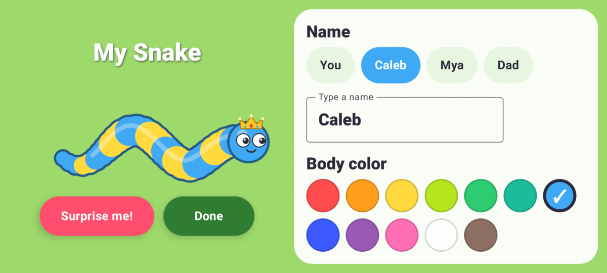

# Sniddle

A cartoony snake game for kids, made for our family's Pixel phones and tablets.
**No ads, no purchases, no accounts, no internet** — the app asks for no
permissions at all and works fully offline.

Grow by eating food dots, gobble up smaller snakes, and steer clear of bigger
ones. Steer with your thumb, anywhere on the screen.

| Pick who's playing | Playing |
| --- | --- |
|  |  |
| **Dress up your snake** | **Game over** |
|  |  |


The arena changes with the seasons: grass and flowers in spring and summer,
golden grass with fallen leaves in October and November, and snow from
December to February.


A kid's first game shows a few tips along the bottom:


These pictures come from the screenshot tests (`:app:testDebugUnitTest` writes
app/build/screenshots, `:game:renderPreviews` writes game/build/previews),
shrunk for the README. Swap in fresh ones when a screen changes.

## How to play

- **Steer**: put your thumb down anywhere and drag it the way you want to go —
  a little ring shows where you started. To turn around, just drag back the
  other way; you never have to reach across the screen. Let go and the snake
  keeps going straight.
- **Grow**: eat the food dots. Your **length** is your score.
- **Bigger = slower.** Small snakes are quick; big snakes are strong.
- **Faces tell you who's who**: a snake that looks *scared* is smaller than you
  (go get it!). A snake with an *angry face and a red outline* is bigger (run!).
  Smiling snakes are about your size — you just bounce off each other.
- **Bite a smaller snake's head** → you eat it whole and grow a lot.
- **Bite a smaller snake's body** → you snip its tail off. The tail falls apart
  into pieces anyone can eat.
- **Bump heads with a bigger snake** → you bounce back and lose a heart ❤️,
  then blink for a moment (you can't be hurt while blinking).
- **Run into a bigger snake's body** → you just bounce off. Only a bigger
  snake's mouth can hurt you, so you always see who's after you.
- **A red arrow with an angry face** at the edge of the screen means a bigger
  snake is coming your way from off-screen. Get moving!
- **A bigger snake bites your body** → your tail falls off. Go back and eat it!
- **Become the biggest snake** in the arena and you get a fanfare, confetti
  and a crown next to your length for as long as you stay on top.
- Lose all 3 hearts and you get gobbled up. Game over — put your name on the
  high-score list!

**Power-ups** glow on the map (arrows at the screen edge point to nearby ones).
Only you can pick them up, and each lasts a few seconds — watch the bar under
your score:

| Power-up | Looks like | What it does |
| --- | --- | --- |
| **Super Strength** | throbbing red ball with a barbell | You win every fight: eat or snip snakes *bigger* than you. Everyone gets scared and runs. |
| **Super Speed** | flickering yellow ball with a lightning bolt | Much faster and turns quicker, with a sparkle trail. |
| **Super Armor** | blue ball with a shield and ripples | Nothing can hurt, snip or eat you. Bigger snakes bounce off — *CLANG!* |

Sound effects go with the big moments (*nom-nom*, *boing*, *clang*, a
power-up jingle, a fanfare when you become the biggest, a sad *wah-wah* when you're gobbled) and a little pop for
every food dot, rising in pitch when you gobble a row of them. The phone also
gives a little buzz for the big moments, and a bouncy tune plays during a
game (it stops when you pause). Three round buttons, on the title screen and
the pause screen, turn the music, the buzz and the sound off and on (sound
off silences the music too). The
phone's media volume sets how loud, and its own *Vibration & haptics* setting
can switch the buzz off too.

Each kid's first game shows three quick tips along the bottom (steer, eat
dots, bigger snakes bite), each moving on by itself when the kid does the
thing. Kids who have finished a game, including everyone who played before
this update, never see them. After
an update, the title screen shows a **New!** card once, listing what's new
(tap it or Play to put it away; a fresh install skips it). When a short
screen has no room for every line, it shows the newest ones.

Switching to another app pauses the game. If the phone closes Sniddle in the
background while you're away, the game is still there when you come back:
paused, with your snake just as long, the same score and hearts. The other
snakes and food are new, and you blink safe for a few seconds.

**Brothers and sisters each get their own snake.** Tap **+ Add player** on
the title screen and a new kid gets a fresh snake to name and dress up. After
that the title screen shows a little picture of everyone's snake: tap yours
before you play. Each kid has their own name, look and unlocked looks (up to
four kids per phone); the sound switches and the "Biggest snakes" list are
shared. The phone remembers who played last. To take a kid off the phone, pick
them, open My Snake and tap **Remove player** at the bottom (it asks first;
their high scores stay, and the last kid can't be removed).

**Little kid mode 🐣** is a switch in each kid's My Snake, off until a grown-up
(or the kid) turns it on. It's the same game, just gentler, for the youngest:
4 hearts instead of 3, half again as much food, more of the other snakes
smaller than you (about 3 in 4 instead of 3 in 5), and bigger snakes that
notice you from less far away, chase you less often, give up sooner and
don't aim ahead of you. They can still bite and gobble you, just less often.
Little-kid games go on the same high-score list with a 🐣 next to the name, and
they count toward unlocking looks like any other game. A paused game that comes
back after Android closed the app carries on just as gentle as it started.

**My Snake** lets you name your snake (the name shows in the "Biggest snakes"
list, and is the first one offered when you get a high score) and pick
colors, a pattern (stripes, polka dots, zigzag, rainbow, checker), eyes and a
hat, and set their birthday (just the month and day; tap it again to change
it or take it away). A few extra looks are earned by playing: a locked
one shows its goal and a bar filling up toward it, and the game-over screen
cheers when you get one:

| Look | How to get it |
| --- | --- |
| Top hat | Reach length 100 |
| Stars pattern | Play 10 games |
| Heart eyes | Eat 10 snakes (all games together) |
| Wizard hat | Reach length 200 |
| Viking horns | Eat 40 snakes (all games together) |

Games played before this existed count too (from the high-score list), for the
first kid on the phone. A new kid starts from zero.

Holiday looks come from playing one game while the holiday is on, and then
they stay for good. Until then they say when to come back. While a holiday
is on, lots of the computer snakes dress up for it too:

| Look | When |
| --- | --- |
| Ghost hat | October |
| Turkey hat | November |
| Santa hat | December |
| Red, white & blue pattern and Star hat | Presidents' Day (12–22 Feb), Memorial Day to the 4th of July (20 May–10 Jul), Veterans Day (8–14 Nov) |
| Hearts pattern | Valentine's Day (7–14 Feb) |
| Shamrock hat | St Patrick's Day (10–17 Mar) |
| Bunny ears | Easter: the Sunday before Easter through Easter Monday (worked out for each year) |
| Birthday cake hat | The kid's own birthday, if they've set it in My Snake |

**Birthdays.** On a kid's birthday, picking them on the title screen sets
off confetti and a "Happy birthday!" with their snake's name, the computer
snakes in their games wear lots of party hats, and playing a game gets them
the birthday cake hat for good. A 29 February birthday is celebrated on
28 February in other years.

The game-over screen also shows who gobbled you, and how long you were the
biggest snake.

## For grown-ups

**Bedtime timer** (off unless you turn it on). Tap the small gear in the
title screen's top corner and answer a times-table question (like
"What is 17 × 8?", typed on the number pad; a wrong answer brings a new
question, so guessing doesn't help). Then pick a daily limit: off, 15, 30,
45, 60 or 90 minutes.

- Only time a game is actually running counts: not paused, not the menus.
  It adds up for the whole phone (brothers and sisters share it) and starts
  again at midnight. Closing the app, or the phone closing it, doesn't reset it.
- Two minutes before the end a "2 minutes left!" note pops up in the game.
- When time's up, the game ends at the first calm moment (no bigger snake
  coming, not mid-bump; at most a minute later). It counts like any finished
  game, and a high score goes on the list under the snake's name. Then the kid's
  snake curls up asleep: "Time to rest, snake! 😴 See you tomorrow!" Play is
  gone until tomorrow; My Snake and the high scores still work.
- **Grown-ups: 10 more minutes** on that screen gives extra time today,
  after the same question.
- Turning the phone's clock back doesn't give more time. (Setting it ahead to
  the next day would; that needs the phone's settings, which you can lock.)

## Install it on a Pixel

Needs **Android 11 or newer**: any recent Pixel, and older phones such as a
Samsung Galaxy Note 10 or Note 20.

1. On the phone, open the **[latest release](../../releases/latest)** and tap
   **`sniddle.apk`** (or use the direct link:
   [`releases/latest/download/sniddle.apk`](../../releases/latest/download/sniddle.apk)).
2. Open the download. Android asks to allow installing apps from that source —
   allow it once.

Or with a cable and `adb`: `adb install -r sniddle.apk`.

Sniddle is still a **beta** (0.x): every push to `main` that passes
[CI](.github/workflows/build.yml) and changes the app publishes a new
[release](../../releases). A push that only touches the README, docs, lint
rules or CI publishes nothing, so phones don't get an update with nothing new.
Releases use [semver](https://semver.org): you set MAJOR.MINOR as `appVersion`
in [`gradle.properties`](gradle.properties), and CI adds the next patch number
(`v0.1.0`, `v0.1.1`, …). Change `appVersion` to `0.2`, and later `1.0`, to start
a new series. **Run workflow** on the
[Build workflow page](../../actions/workflows/build.yml) makes a release on demand
from any branch. Separately, the build number is the app's version code, and every
build is signed with the same key ([`app/debug.keystore`](app/debug.keystore),
committed on purpose; it is not secret and not for the Play Store), so a new
release **installs over the old one and keeps the high scores**. (A local
`0.1-dev` build can't replace a newer release; uninstall first.)

## Build it yourself

You need JDK 21 and the Android SDK with **platform 37.2** (Android 17).

```sh
./gradlew lintAll                    # every linter (see below)
./gradlew :game:test                 # game rules unit tests (incl. 10 000-step soak tests)
./gradlew :app:testDebugUnitTest     # renders every screen (phone portrait + landscape, tablet)
                                     #   to app/build/screenshots/
./gradlew :app:assembleRelease       # -> app/build/outputs/apk/release/app-release.apk
./gradlew :app:assembleDebug         # -> app/build/outputs/apk/debug/app-debug.apk
```

[CI](.github/workflows/build.yml) runs all of these on every push, keeps the
screenshots as a downloadable artifact and publishes the APK as a release.

Handy extras that need no phone:

```sh
./gradlew :game:renderPreviews   # PNGs of the real game art -> game/build/previews/
./gradlew :game:balanceReport    # bot-played games: survival time, score, size mix
./gradlew :game:soundPreviews    # every effect + the music loop as WAVs -> game/build/sounds/
./gradlew :game:benchmark        # time per sim step and per frame, plus a checksum of the final world
                                 #   (--args=AUTUMN or --args=SNOW draws that season's arena)
```

Toolchain: Gradle 9.9, Android Gradle Plugin 9.5 (built-in Kotlin), Kotlin 2.4,
Jetpack Compose (BOM 2026.09), compileSdk 37.2 / targetSdk 37 / minSdk 30.
Versions live in [`gradle/libs.versions.toml`](gradle/libs.versions.toml). The
app ID / namespace is `com.quissicutdeus.snake` (from snake.quissicutdeus.com).

## Linters

`./gradlew lintAll` runs all of them; any finding fails the build (and CI).

| Tool | Checks | Config |
| --- | --- | --- |
| **ktlint** (via Spotless) | formatting and Kotlin style; `./gradlew spotlessApply` fixes most of it | [`.editorconfig`](.editorconfig) |
| **detekt** | code smells: complexity, long functions, magic numbers in game logic, unused private code, likely bugs | [`config/detekt/detekt.yml`](config/detekt/detekt.yml) |
| **Android Lint** | every check switched on, for the app *and* the pure-Kotlin game module, plus Slack's Compose rules | [`app/lint.xml`](app/lint.xml) |
| **Kotlin compiler** | all warnings are errors, with the extra K2 checks on (unused variables, redundant code…) | [`app/build.gradle.kts`](app/build.gradle.kts), [`game/build.gradle.kts`](game/build.gradle.kts) |
| **Dead code** (`./gradlew deadCode`) | R8 shrinks a special build without optimizing; anything it can drop is code the app never uses | [`config/deadcode-allowlist.txt`](config/deadcode-allowlist.txt) |

Every rule that is switched off or loosened is explained next to the setting.

## Tune the game

All gameplay numbers live in one file (detekt makes sure they stay there):
[`game/src/main/kotlin/com/quissicutdeus/snake/game/GameConfig.kt`](game/src/main/kotlin/com/quissicutdeus/snake/game/GameConfig.kt).
After a change, run `./gradlew :game:test :game:balanceReport` to see how games go.
The few numbers that make little kid mode gentler (hearts, food, the share of
smaller snakes, how bigger snakes chase you) are in
[`Difficulty.kt`](game/src/main/kotlin/com/quissicutdeus/snake/game/Difficulty.kt)
next to it; `LittleKidTest` checks it stays gentler than a normal game.

| Want… | Change |
| --- | --- |
| Easier | more `PLAYER_HEARTS`, longer `HURT_INVULNERABLE_SECONDS`, lower `AI_AGGRESSION` or `AI_SPEED_FACTOR`, higher `SMALLER_FRACTION` |
| Harder | the opposite, or more `AI_TARGET_COUNT` |
| Faster growth | `PELLET_VALUE`, `PELLET_COUNT`, `EAT_WHOLE_GAIN` |
| Faster / slower snakes | `MAX_SPEED`, `SPEED_FLOOR_FRACTION`, `TURN_RATE` |
| Bigger arena | `ARENA_WIDTH`, `ARENA_HEIGHT` (and more `PELLET_COUNT`) |
| See more / less of the arena | `BASE_VIEW_SPAN` |
| Fatter / thinner snakes | `START_RADIUS`, `RADIUS_GROWTH_EXPONENT` |
| More / fewer power-ups | `POWER_UP_MAX`, `POWER_UP_INTERVAL`, `POWER_UP_LIFETIME` |
| Longer / shorter powers | `STRENGTH_SECONDS`, `SPEED_SECONDS`, `ARMOR_SECONDS`, `SPEED_POWER_FACTOR` |

## How it's built

```text
game/   pure Kotlin, no Android: all rules, AI and drawing code
  model/   Snake (body follows the head's trail), food, SnakeStyle, scores,
           Holiday (which are on for a date, and dressing computer snakes
           up), Dates (leap years, Easter, Birthday), ArenaSeason
  sim/     GameSim (fixed 60 Hz steps), Movement, Collisions (spatial grid),
           Rules, PowerUps, Ai, Spawner, Danger (warning arrows), Biggest
           (who's on top), Scoreboard, SavedRun (a game to carry on after
           Android closes the app)
  render/  Canvas2D (tiny drawing interface), SnakeArt / FaceArt / HatArt /
           FoodArt / PowerUpArt, HolidayHatArt / CalendarArt (holiday looks),
           SceneRenderer + ArenaArt (the floor, per season) + HudRenderer, Camera,
           Fx (particles, comic words, shake), Haptics (which buzz when),
           PosedSnake
  audio/   Synth (makes every sound effect from scratch), Music (the game
           tune, same way), SoundCues (which sound when)
  test/    unit + soak tests; Java2D Canvas2D for PNG previews
app/    Android app (Jetpack Compose)
  ComposeCanvas2D   draws the game art on the Compose canvas
  ui/               Title, Game (frame loop + thumbstick + pause),
                    Game over ("Who played?"), High scores, My Snake,
                    WhoIsPlaying (pick a kid), Profile (the kid playing,
                    and today's holidays, birthday and arena season: the
                    only place the date is read), BirthdaySetting (the
                    picker), BirthdayCheer (title-screen cheer + confetti)
  Storage           shared: top-10 scores, names, settings, who's playing;
                    SavedPlayer: each kid's look, name, birthday, unlock totals
                    (SharedPreferences; the first kid keeps the keys from
                    before players existed, so updates lose nothing);
                    also the newest news seen, per phone
  ui/FirstGameTips  the first-game tips; ui/News the "New!" lines (add
                    one per release with the next number)
  PlayClock         the bedtime timer's count (pure Kotlin, unit-tested);
                    ui/Bedtime, ui/GrownUps (gear, question, settings),
                    ui/RestScreen
  SoundPlayer       plays the effects (one preloaded AudioTrack each) and
                    loops the music
```

The simulation runs at a fixed 60 steps per second; drawing blends between
the last two steps so motion stays smooth on 90/120 Hz Pixel screens. Because
the game logic and art don't depend on Android, an iOS version could reuse them
one day.

`app/src/main/baseline-prof.txt` lists the app's code for Android to compile
ahead of time at install (profileinstaller does this for sideloaded APKs too),
so the first rounds after an update don't stutter.

The original design notes are in [`PLAN.md`](PLAN.md). Ideas for later: levels,
iOS, Play Store.
