# Sniddle

A cartoony snail game for kids, made for our family's phones and tablets.
Every snail leaves a slime trail behind it, and the longer your trail, the
bigger you are.
**No ads, no purchases, no accounts, no internet** — the app asks for no
permissions at all and works fully offline.

Grow by eating food dots, gobble up smaller snails, and steer clear of bigger
ones. Steer with your thumb, anywhere on the screen.

| Pick who's playing | Playing |
| --- | --- |
| 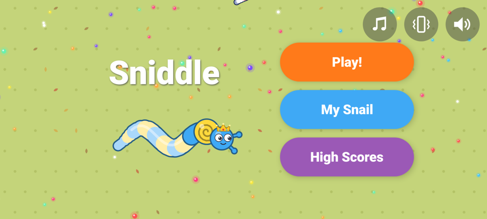 | 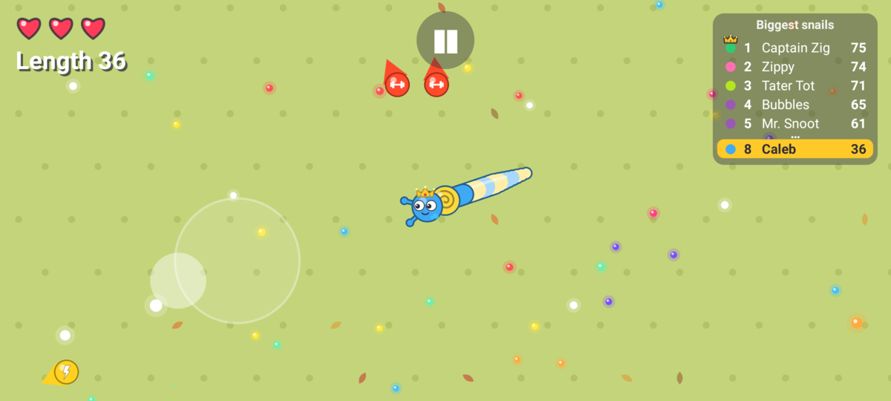 |
| **Dress up your snail** | **Game over** |
| 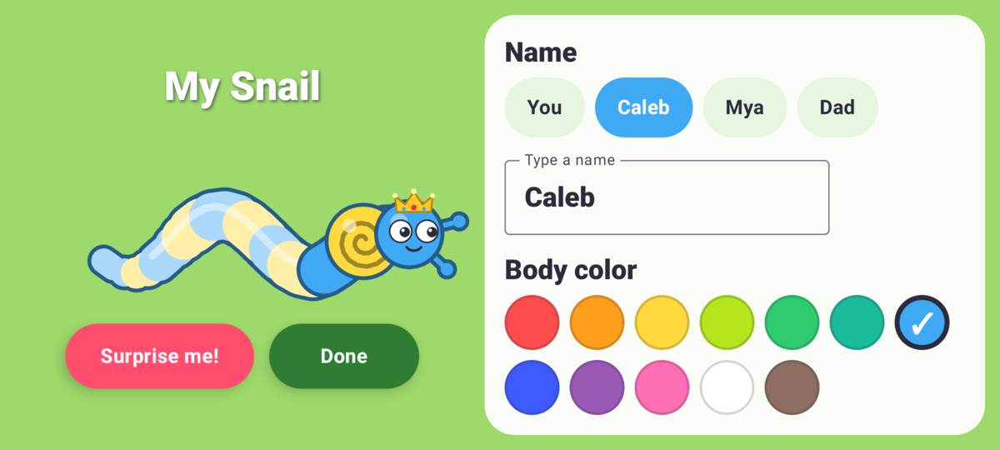 | 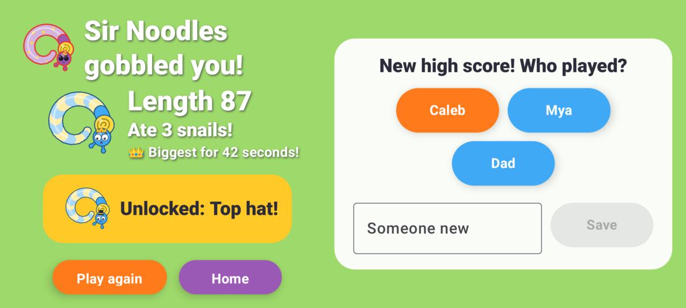 |

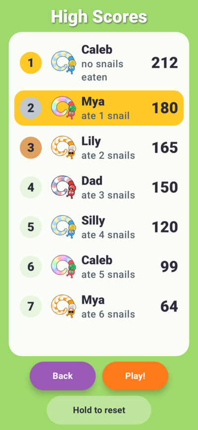

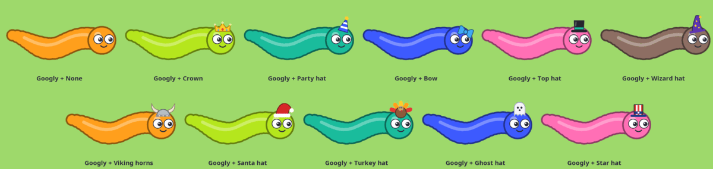

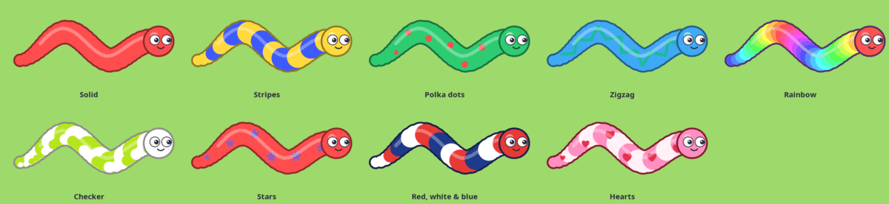

The arena changes with the seasons: grass and flowers in spring and summer,
golden grass with fallen leaves in October and November, and snow in
January and February (December is wrapping paper, below).

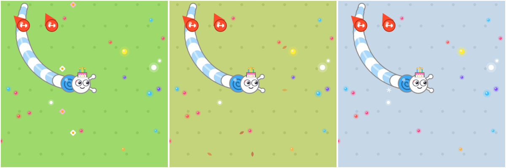

The title screen always shows the season's arena. A game is played there
about half the time; otherwise it's in a garden bed (brown soil with pebbles,
little sprouts and the odd worm saying hello) or out in space (a starry sky
with planets and a comet), a quarter of the time each. Two kids playing
together get one pick for their game. A paused game that comes back after the
phone closed the app comes back on the same floor.

All through December, the title screen and every game are on wrapping paper
instead: green stripes printed with presents, holly and candy
canes, tied up with a big red ribbon and a bow.

A kid's first game shows a few tips along the bottom:

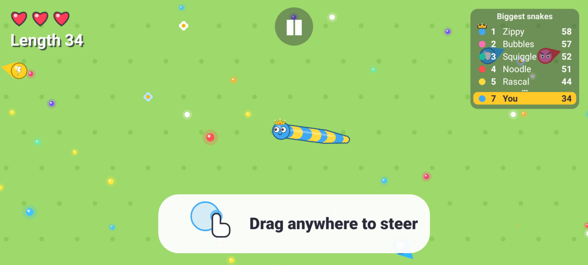

These pictures come from the screenshot tests (`:app:testDebugUnitTest` writes
app/build/screenshots, `:game:renderPreviews` writes game/build/previews),
shrunk for the README. Swap in fresh ones when a screen changes.

## How to play

- **Steer**: put your thumb down anywhere and drag it the way you want to go —
  a little ring shows where you started. To turn around, just drag back the
  other way; you never have to reach across the screen. Let go and the snail
  keeps going straight.
- **Grow**: eat the food dots and your slime trail gets longer. Its **length**
  is your score.
- **Bigger = slower.** Small snails are quick; big snails are strong.
- **Faces tell you who's who**: a snail that looks *scared* is smaller than you
  (go get it!). A snail with an *angry face and a red outline* is bigger (run!).
  Smiling snails are about your size — you just bounce off each other.
- **Bite a smaller snail's head** → you eat it whole and grow a lot.
- **Bite a smaller snail's slime trail** → you snip it off. The loose trail
  falls apart into pieces anyone can eat.
- **Bump heads with a bigger snail** → you bounce back and lose a heart ❤️,
  then blink for a moment (you can't be hurt while blinking).
- **Run into a bigger snail's slime trail** → you just bounce off. Only a bigger
  snail's mouth can hurt you, so you always see who's after you.
- **A red arrow with an angry face** at the edge of the screen means a bigger
  snail is coming your way from off-screen, at your head or at your slime
  trail. Get moving!
- **A bigger snail bites your slime trail** → the end falls off. Go back and eat it!
- **Become the biggest snail** in the arena and you get a fanfare, confetti
  and a crown next to your length for as long as you stay on top.
- Lose all 3 hearts and you get gobbled up. Game over — put your name on the
  high-score list!

**Power-ups** glow on the map (arrows at the screen edge point to nearby ones).
Only you can pick them up, and each lasts a few seconds — watch the bar under
your score:

| Power-up | Looks like | What it does |
| --- | --- | --- |
| **Super Strength** | throbbing red ball with a barbell | You win every fight: eat or snip snails *bigger* than you. Everyone gets scared and runs. |
| **Super Speed** | flickering yellow ball with a lightning bolt | Much faster and turns quicker, with a sparkle trail. |
| **Super Armor** | blue ball with a shield and ripples | Nothing can hurt, snip or eat you. Bigger snails bounce off — *CLANG!* |

Sound effects go with the big moments (*nom-nom*, *boing*, *clang*, a
power-up jingle, a fanfare when you become the biggest, a sad *wah-wah* when you're gobbled) and a little pop for
every food dot, rising in pitch when you gobble a row of them. The phone also
gives a little buzz for the big moments, and a bouncy tune plays during a
game (it stops when you pause). Three round buttons, on the title screen and
the pause screen, turn the music, the buzz and the sound off and on (sound
off silences the music too). The
phone's media volume sets how loud, and its own *Vibration & haptics* setting
can switch the buzz off too.

Each kid's first game shows three quick tips along the bottom (steer, eat
dots, bigger snails bite), each moving on by itself when the kid does the
thing. Kids who have finished a game, including everyone who played before
this update, never see them. After
an update, the title screen shows a **New!** card once, listing what's new
(tap it or Play to put it away; a fresh install skips it). When a short
screen has no room for every line, it shows the newest ones.

Switching to another app pauses the game. If the phone closes Sniddle in the
background while you're away, the game is still there when you come back:
paused, with your snail just as long, the same score and hearts. The other
snails and food are new, and you blink safe for a few seconds.

**Brothers and sisters each get their own snail.** Tap **+ Add player** on
the title screen and a new kid gets a fresh snail to name and dress up. After
that the title screen shows a little picture of everyone's snail: tap yours
before you play. Each kid has their own name, look and unlocked looks (up to
four kids per phone); the sound switches and the "Biggest snails" list are
shared. The phone remembers who played last. To take a kid off the phone, pick
them, open My Snails and tap **Remove player** at the bottom (it asks first;
their high scores stay, and the last kid can't be removed).

**Little kid mode 🐣** is a switch in each kid's My Snails, off until a grown-up
(or the kid) turns it on. It's the same game, just gentler, for the youngest:
4 hearts instead of 3, half again as much food, more of the other snails
smaller than you (about 3 in 4 instead of 3 in 5), and bigger snails that
notice you from less far away, chase you less often, give up sooner and
don't aim ahead of you. They can still bite and gobble you, just less often.
Little-kid games go on the same high-score list with a 🐣 next to the name, and
they count toward unlocking looks like any other game. A paused game that comes
back after Android closed the app carries on just as gentle as it started.

**Play together.** On a tablet, or a big phone turned sideways, the title
screen has a **Play together** button: two kids play at once in the same
arena, each on their own half of the screen. The kid picked on the title
screen plays on the left; the next screen asks who plays on the right
(the next kid to start with, or a "Player 2" with a random look when only
one kid is on the phone, or **Add player** to make a new one). Each kid
steers by putting a thumb down on their own half (a finger belongs to the
half it started in, even if it slides across), and each half follows its
own snail with its own hearts, length and warning arrows.

- The usual rules hold between the two kids too: a bigger head gobbles a
  smaller one. But a gobbled kid isn't out: "Oops! Back in 3…", and they
  come back somewhere quiet as a fresh small snail, blinking safe for a
  moment. Their best length and snails eaten so far still count.
- The game lasts **3 minutes** (the clock under the pause button), then
  *Time's up! Who's biggest?* The end screen shows both snails, both
  lengths and a cheer for both. Each kid's best length goes on the "Biggest
  snails" list under their own name if it made it, and counts toward their
  own unlocked looks.
- It's the gentle little-kid game only when **both** kids have little kid
  mode on (a "Player 2" guest counts as not little), and the computer snails
  dress up for either kid's birthday. Two-player games count toward the
  bedtime timer like any other, and stop at a calm moment when it runs out.
- Pause stops both halves. Unlike a one-player game, a two-player game
  isn't kept if the phone closes Sniddle in the background: you start from
  the title screen again.

| Two kids, one screen | Who's biggest? |
| --- | --- |
| 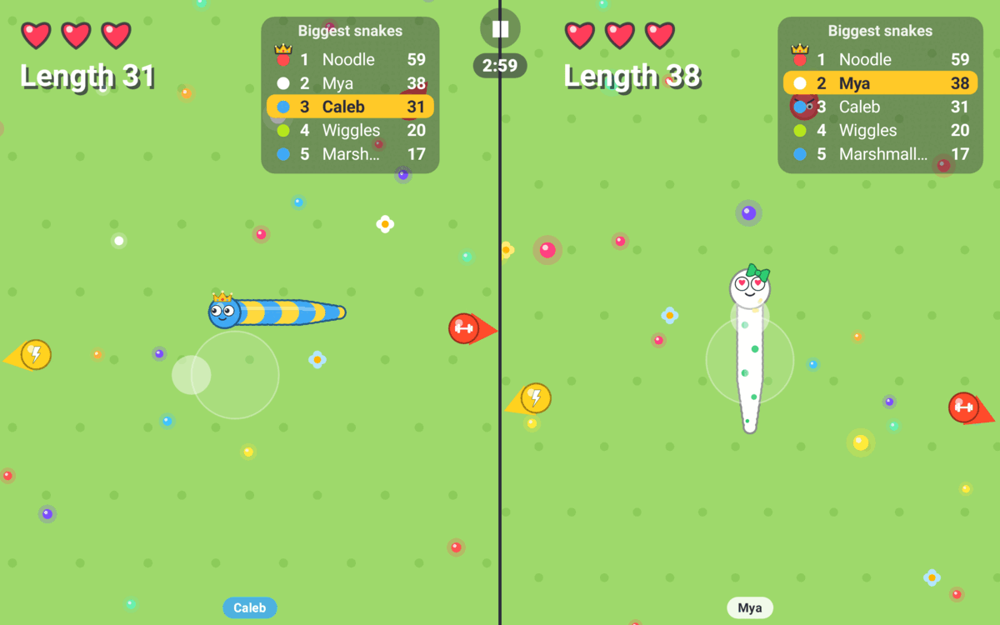 | 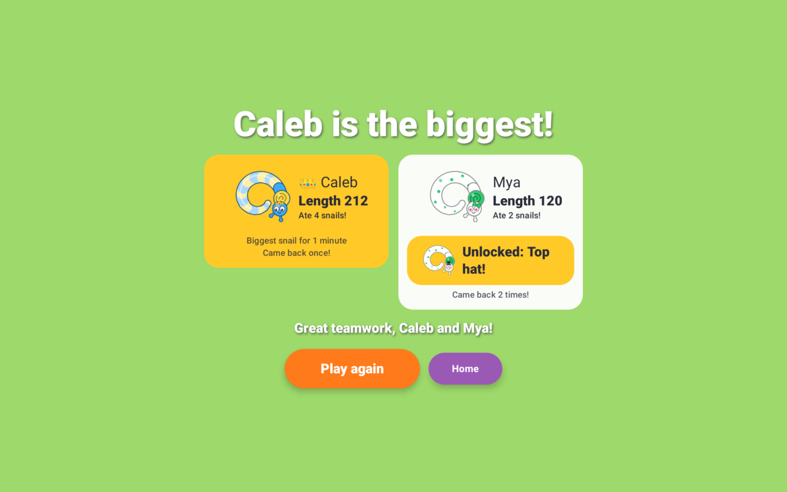 |

**My Snails** lets you name your snail (the name shows in the "Biggest snails"
list, and is the first one offered when you get a high score) and pick
colors, a pattern (stripes, polka dots, zigzag, rainbow, checker), eyes
(googly, sleepy, sunglasses, glasses) and their color (classic dark, or the
snail's body or shell color), and a hat (crown, party hat, bow, cowboy hat,
flower crown), and set their birthday (just the month and day; tap it again
to change it or take it away). A few extra looks are earned by
playing: a locked one shows its goal and a bar filling up toward it, and the
game-over screen cheers when you get one:

| Look | How to get it |
| --- | --- |
| Propeller cap | Play 5 games |
| Top hat | Reach length 100 |
| Stars pattern | Play 10 games |
| Heart eyes | Eat 10 snails (all games together) |
| Star eyes | Reach length 150 |
| Wizard hat | Reach length 200 |
| Pirate hat | Eat 25 snails (all games together) |
| Sparkly eyes | Play 25 games |
| Viking horns | Eat 40 snails (all games together) |

Whatever the eyes, a snail's face still shows who's who: scared when it's
smaller than you, angry when it's bigger.

Games played before this existed count too (from the high-score list), for the
first kid on the phone. A new kid starts from zero.

Holiday looks come from playing one game while the holiday is on, and then
they stay for good. Until then they say when to come back. While a holiday
is on, lots of the computer snails dress up for it too:

| Look | When |
| --- | --- |
| Ghost hat | October |
| Turkey hat | November |
| Santa hat | December |
| Red, white & blue pattern and Star hat | Presidents' Day (12–22 Feb), Memorial Day to the 4th of July (20 May–10 Jul), Veterans Day (8–14 Nov) |
| Hearts pattern | February, for Valentine's Day |
| Shamrock hat | March, for St Patrick's Day |
| Bunny ears | April, for Easter (and Easter week itself in the years it comes in March) |
| Birthday cake hat | The kid's own birthday, if they've set it in My Snails |

**Birthdays.** On a kid's birthday, picking them on the title screen sets
off confetti and a "Happy birthday!" with their snail's name, the computer
snails in their games wear lots of party hats, and playing a game gets them
the birthday cake hat for good. A 29 February birthday is celebrated on
28 February in other years.

The game-over screen also shows who gobbled you, and how long you were the
biggest snail.

## For grown-ups

**Night look.** When the phone is set to dark mode, the menus turn a deep
garden green with light text; the arena and the snails look the same as by
day.

**Bedtime timer** (off unless you turn it on). Tap the small gear in the
title screen's top corner and answer a times-table question (like
"What is 14 × 4?", typed on the number pad; a wrong answer brings a new
question, so guessing doesn't help). Then pick a daily limit: off, 15, 30,
45, 60 or 90 minutes.

- Only time a game is actually running counts: not paused, not the menus.
  It adds up for the whole phone (brothers and sisters share it) and starts
  again at midnight. Closing the app, or the phone closing it, doesn't reset it.
- Two minutes before the end a "2 minutes left!" note pops up in the game.
- When time's up, the game ends at the first calm moment (no bigger snail
  coming, not mid-bump; at most a minute later). It counts like any finished
  game, and a high score goes on the list under the snail's name. Then the kid's
  snail curls up asleep: "Time to rest, snail! 😴 See you tomorrow!" Play is
  gone until tomorrow; My Snails and the high scores still work.
- **Grown-ups: 10 more minutes** on that screen gives extra time today,
  after the same question.
- Turning the phone's clock back doesn't give more time. (Setting it ahead to
  the next day would; that needs the phone's settings, which you can lock.)

## Install it on Android

Needs **Android 8 or newer**, on a phone or a tablet.

1. On the phone, open the **[latest release](../../releases/latest)** and tap
   **`sniddle.apk`** (or use the direct link:
   [`releases/latest/download/sniddle.apk`](../../releases/latest/download/sniddle.apk)).
2. Open the download. Android asks to allow installing apps from that source —
   allow it once.

Or with a cable and `adb`: `adb install -r sniddle.apk`.

## Install it on an iPhone or iPad

Needs **iOS 16 or newer**. Every release also has **`sniddle.ipa`**
([`releases/latest/download/sniddle.ipa`](../../releases/latest/download/sniddle.ipa)).
There's no App Store and no paid developer account: a Linux computer installs
it over a cable with [Impactor](https://github.com/khcrysalis/PlumeImpactor),
signed with a free Apple ID, and it has to be installed again **every week** or
it stops opening (the saved scores stay). [Sniddle on iPhone and iPad](docs/ios.md)
has the step-by-step.

The title screen shows which version is installed, small at the bottom (`v0.2.8`).

Sniddle is still a **beta** (0.x): every push to `main` that passes
[CI](.github/workflows/build.yml) and changes the app publishes a new
[release](../../releases). A push that only touches the README, docs, lint
rules or CI publishes nothing, so phones don't get an update with nothing new.
Releases use [semver](https://semver.org): you set MAJOR.MINOR as `appVersion`
in [`gradle.properties`](gradle.properties), and CI adds the next patch number
(`v0.2.0`, `v0.2.1`, …). Change `appVersion` to `0.3`, and later `1.0`, to start
a new series. **Run workflow** on the
[Build workflow page](../../actions/workflows/build.yml) makes a release on demand
from any branch. Separately, the build number is the app's version code, and every
build is signed with the same key ([`app/debug.keystore`](app/debug.keystore),
committed on purpose; it is not secret and not for the Play Store), so a new
release **installs over the old one and keeps the high scores**. (A local
`0.2-dev` build can't replace a newer release; uninstall first.)

The one exception: releases before 0.2 were the snake game, with a different
app ID. Android treats 0.2 as a new app, so it installs beside the old one
and starts with empty high scores; uninstall the old Sniddle by hand.

## Build it yourself

You need JDK 21 and the Android SDK with **platform 37.2** (Android 17).

```sh
./gradlew lintAll                    # every linter (see below)
./gradlew :game:test                 # game rules unit tests (incl. 10 000-step soak tests)
./gradlew :composeApp:testAndroidHostTest  # the shared screens' own tests
./gradlew :app:testDebugUnitTest     # renders every screen (phone portrait + landscape, tablet)
                                     #   to app/build/screenshots/
./gradlew :app:assembleRelease       # -> app/build/outputs/apk/release/app-release.apk
./gradlew :app:assembleDebug         # -> app/build/outputs/apk/debug/app-debug.apk
```

[CI](.github/workflows/build.yml) runs all of these on every push, keeps the
screenshots as a downloadable artifact and publishes the APK as a release.

Handy extras that need no phone:

```sh
./gradlew :game:renderPreviews   # PNGs of the real game art -> game/build/previews/
./gradlew :game:balanceReport    # bot-played games: survival time, score, size mix
./gradlew :game:soundPreviews    # every effect + the music loop as WAVs -> game/build/sounds/
./gradlew :game:benchmark        # time per sim step and per frame, plus a checksum of the final world
                                 #   (--args=AUTUMN, SNOW, DIRT, SPACE or WRAPPING_PAPER draws that floor)
```

Toolchain: Gradle 9.9, Android Gradle Plugin 9.5 (built-in Kotlin), Kotlin 2.4,
Jetpack Compose (BOM 2026.09), compileSdk 37.2 / targetSdk 37 / minSdk 26.
Versions live in [`gradle/libs.versions.toml`](gradle/libs.versions.toml). The
app ID / namespace is `com.quissicutdeus.sniddle`.

## Linters

`./gradlew lintAll` runs all of them; any finding fails the build (and CI).

| Tool | Checks | Config |
| --- | --- | --- |
| **ktlint** (via Spotless) | formatting and Kotlin style; `./gradlew spotlessApply` fixes most of it | [`.editorconfig`](.editorconfig) |
| **detekt** | code smells: complexity, long functions, magic numbers in game logic, unused private code, likely bugs | [`config/detekt/detekt.yml`](config/detekt/detekt.yml) |
| **Android Lint** | every check switched on, for the app, the shared screens *and* the pure-Kotlin game module, plus Slack's Compose rules | [`app/lint.xml`](app/lint.xml) |
| **Kotlin compiler** | all warnings are errors, with the extra K2 checks on (unused variables, redundant code…) | [`build-logic`](build-logic) |
| **Dead code** (`./gradlew deadCode`) | R8 shrinks a special build without optimizing; anything it can drop is code the app never uses | [`config/deadcode-allowlist.txt`](config/deadcode-allowlist.txt) |

Every rule that is switched off or loosened is explained next to the setting.

## Tune the game

All gameplay numbers live in one file (detekt makes sure they stay there):
[`game/src/commonMain/kotlin/com/quissicutdeus/sniddle/game/GameConfig.kt`](game/src/commonMain/kotlin/com/quissicutdeus/sniddle/game/GameConfig.kt).
After a change, run `./gradlew :game:test :game:balanceReport` to see how games go.
The few numbers that make little kid mode gentler (hearts, food, the share of
smaller snails, how bigger snails chase you) are in
[`Difficulty.kt`](game/src/commonMain/kotlin/com/quissicutdeus/sniddle/game/Difficulty.kt)
next to it; `LittleKidTest` checks it stays gentler than a normal game.

| Want… | Change |
| --- | --- |
| Easier | more `PLAYER_HEARTS`, longer `HURT_INVULNERABLE_SECONDS`, lower `AI_AGGRESSION` or `AI_SPEED_FACTOR`, higher `SMALLER_FRACTION` |
| Harder | the opposite, or more `AI_TARGET_COUNT` |
| Faster growth | `PELLET_VALUE`, `PELLET_COUNT`, `EAT_WHOLE_GAIN` |
| Faster / slower snails | `MAX_SPEED`, `SPEED_FLOOR_FRACTION`, `TURN_RATE` |
| Bigger arena | `ARENA_WIDTH`, `ARENA_HEIGHT` (and more `PELLET_COUNT`) |
| See more / less of the arena | `BASE_VIEW_SPAN` |
| Fatter / thinner snails | `START_RADIUS`, `RADIUS_GROWTH_EXPONENT` |
| More / fewer power-ups | `POWER_UP_MAX`, `POWER_UP_INTERVAL`, `POWER_UP_LIFETIME` |
| Longer / shorter powers | `STRENGTH_SECONDS`, `SPEED_SECONDS`, `ARMOR_SECONDS`, `SPEED_POWER_FACTOR` |

## How it's built

```text
game/   shared Kotlin for Android and iOS: all rules, AI and drawing code
  model/   Snail (its slime trail is the path its head took), food,
           SnailStyle, scores,
           Holiday (which are on for a date, and dressing computer snails
           up), Dates (leap years, Easter, Birthday), ArenaSeason
  sim/     GameSim (fixed 60 Hz steps), Movement, Collisions (spatial grid),
           Rules, PowerUps, Ai, Spawner (with Sight: what a kid's screen
           shows, and Sightings: which snails a kid has seen), Danger
           (warning arrows), Biggest
           (who's on top), Scoreboard, SavedRun (a game to carry on after
           Android closes the app), TwoPlayer (a second kid in the same
           world: comebacks, the shared clock, each kid's crown)
  render/  Canvas2D (tiny drawing interface), SnailArt (a whole snail: its slime trail, then
           SnailBodyArt, the snail at the front) / FaceArt / HatArt /
           FoodArt / PowerUpArt, HolidayHatArt / CalendarArt (holiday looks),
           SceneRenderer + ArenaArt (the floor: seasons, DirtArt, SpaceArt,
           WrappingPaperArt) + HudRenderer, Camera,
           Fx (particles, comic words, shake), Haptics (which buzz when),
           PosedSnail
  audio/   Synth (makes every sound effect from scratch), Music (the game
           tune, same way), SoundCues (which sound when)
  test/    unit + soak tests; Java2D Canvas2D for PNG previews
composeApp/  the app's screens, shared by Android and iOS (Compose Multiplatform)
  commonMain/
    ComposeCanvas2D   draws the game art on the Compose canvas
    ui/               Title, GameLoop (the frame loop every game runs on, and
                      a Seat per kid: camera, effects, thumbstick, sounds),
                      Game (one seat + pause),
                      Game over ("Who played?"), High scores, My Snails,
                      WhoIsPlaying (pick a kid), Profile (the kid playing,
                      and today's holidays, birthday and arena season: the
                      only place the date is read), BirthdaySetting (the
                      picker), BirthdayCheer (title-screen cheer + confetti),
                      TwoPlayerScreen / TwoPlayerGame (split screen: two
                      seats, one per half), TogetherScreen (picking the second kid,
                      recording both), TogetherOverScreen
    Storage           shared: top-10 scores, names, settings, who's playing;
                      SavedPlayer: each kid's look, name, birthday, unlock totals
                      (in a KeyValueStore; on Android the first kid keeps the
                      keys from before players existed, so updates lose nothing);
                      also the newest news seen, per phone
    ui/FirstGameTips  the first-game tips; ui/News the "New!" lines (add
                      one per release with the next number)
    PlayClock         the bedtime timer's count (pure Kotlin, unit-tested);
                      ui/Bedtime, ui/GrownUps (gear, question, settings),
                      ui/RestScreen
    SavedUiState      a paused game's screen state as text, for iOS to keep
    SoundOutput,      what each platform provides: sound, the buzz, today's
    PhoneCalendar,    date, saved data
    KeyValueStore
  androidMain/        AndroidCanvas2D, the back gesture
  iosMain/            MainViewController (the whole app for iOS), SkiaCanvas2D,
                      IosSound, IosBuzzer, IosCalendar, UserDefaultsStore,
                      PersistedUiState (brings a game back after iOS closes the app)
app/    the Android app around it
  MainActivity, SharedPreferencesStore, SystemCalendar, ViewBuzzer,
  SoundPlayer       plays the effects (one preloaded AudioTrack each) and
                    loops the music
  test/             Robolectric screenshot and screen tests
iosApp/ the iPhone and iPad app around it: SniddleApp.swift, the icon, and
        project.yml (XcodeGen; CI generates and builds the Xcode project)
build-logic/  the sniddle.quality plugin every module applies: compiler checks,
              detekt, Android Lint, JDK 21
```

The simulation runs at a fixed 60 steps per second; drawing blends between
the last two steps so motion stays smooth on 90 and 120 Hz screens. The game
logic and art don't depend on Android, and the screens are Compose
Multiplatform, so the iPhone and iPad app runs the same code; only sound, the
buzz, the date, saved data and drawing text differ (see [docs/ios.md](docs/ios.md)).

A two-player game is one `GameSim` with two player snails, so the kids can
meet and gobble each other. The screen is two Compose canvases side by side,
each clipped to its half; the renderer draws the whole world once per half,
from that kid's point of view (`SceneRenderer.draw(..., me = kid)`). That is
about twice the drawing of one full screen: `:game:benchmark` ends with a
tablet comparison (two 1280x1600 halves vs one 2560x1600 screen).
Both kinds of game run on the same `GameLoop`; a one-player game is simply one
seat that fills the screen.

In the code a snail's slime trail is its "body" or "tail" (the head moves and
the trail is the path it took). A trail is drawn as a few thick round-ended
lines (only the part on screen), not a circle per body circle.

`app/src/main/baseline-prof.txt` lists the app's code for Android to compile
ahead of time at install (profileinstaller does this for sideloaded APKs too),
so the first rounds after an update don't stutter.

The original design notes are in [`PLAN.md`](PLAN.md). Ideas for later: levels,
Play Store.
